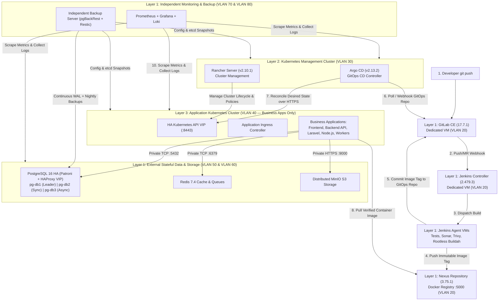

# Platform Architecture Overview (3-Layer Design)

## 1. Core Architectural Principle

**Kubernetes application clusters must run business applications only. All infrastructure services, databases, object storage, monitoring, backup services, and DevOps tools operate independently of the application cluster.**

The platform is strictly separated into three architectural layers on **Ubuntu Server 24.04 LTS (`noble`)**:

| Layer | Name | Hosted Services & Workloads | Deployment Target |
| :--- | :--- | :--- | :--- |
| **Layer 1** | **DevOps, Stateful Data, Storage & Observability Infrastructure** *(Outside Kubernetes)* | <ul><li>**GitLab CE (`17.7.1-ce.0`):** Dedicated VM for SCM & GitOps repos</li><li>**Jenkins Controller (`2.479.3`) + Jenkins Agents:** Dedicated VMs for CI builds, tests, Trivy scans & rootless Buildah builds</li><li>**Sonatype Nexus (`3.75.1-01`):** Dedicated VM for OCI container images & artifacts</li><li>**PostgreSQL 16 HA (`pg-db1`, `pg-db2`, `pg-db3`):** Dedicated database VMs with Patroni + etcd + HAProxy VIP + `pgBackRest`</li><li>**Redis (`7.4`):** Dedicated VM / Sentinel HA for cache, queues, and sessions</li><li>**MinIO S3 Storage:** Dedicated storage infrastructure (4-node distributed erasure coding in production)</li><li>**Prometheus (`2.53.3`), Grafana (`11.4.0`), Loki (`3.3.2`):** Independent monitoring & logging VMs</li><li>**Backup Services:** Independent backup server (`pgBackRest`, Restic, etcd/config archives)</li></ul> | Dedicated Ubuntu 24.04 VMware VMs (`VLAN 20`, `50`, `60`, `70`, `80`) |
| **Layer 2** | **Kubernetes Management Cluster** | <ul><li>**Rancher (`v2.10.1`):** Multi-cluster Kubernetes management & RBAC</li><li>**Argo CD (`v2.13.2`):** Kubernetes-native GitOps continuous delivery controller</li></ul> | Dedicated small Kubernetes cluster (`k8s_mgmt_cluster`, `VLAN 30`) |
| **Layer 3** | **Application Kubernetes Cluster** | <ul><li>**Business Workloads Only:** Frontend web apps, Backend APIs, Laravel apps, Node.js services, Microservices, Background workers, Scheduled CronJobs</li><li>**Required K8s Plumbing Only:** Calico CNI (`v3.29.1`), CoreDNS, Ingress NGINX Controller, CSI drivers, Node Exporter / Promtail daemon agents</li></ul> | Production HA Kubernetes cluster (`k8s_app_cluster`, 3 CP + 3+ Workers, `VLAN 40`) |

---

## 2. End-to-End CI/CD & GitOps Workflow Across the 3 Layers

---

## 3. Why Argo CD and Rancher Run in the Layer 2 Management Cluster

1. **Argo CD is Kubernetes-Native:** Argo CD consists of Kubernetes controllers (`argocd-application-controller`, `argocd-repo-server`, `argocd-server`) that require a Kubernetes API and `etcd` datastore; it is **not** a standalone Linux systemd binary.
2. **Fault & Blast-Radius Isolation:** By hosting Argo CD and Rancher in a small, dedicated **Management Kubernetes Cluster (`k8s_mgmt_cluster`)** rather than inside the **Application Kubernetes Cluster (`k8s_app_cluster`)**:
   - Resource exhaustion, noisy-neighbor pods, or CNI maintenance in the application cluster never take down the control plane used to manage or roll back applications.
   - A single Argo CD & Rancher management plane can govern multiple downstream application clusters (`dev`, `staging`, `production`).
   - Application clusters remain 100% dedicated to business workloads.

---

## 4. Architecture Diagrams Index (`docs/diagrams/`)

All 12 editable Draw.io diagrams (`*.drawio`, compatible with [diagrams.net](https://app.diagrams.net)) are located in [`docs/diagrams/`](file:///Users/ratanakieng/labs/onprem-devops-platform/docs/diagrams/):

1. [`01-high-level-architecture.drawio`](file:///Users/ratanakieng/labs/onprem-devops-platform/docs/diagrams/01-high-level-architecture.drawio) — High-Level 3-Layer Architecture
2. [`02-detailed-infrastructure-architecture.drawio`](file:///Users/ratanakieng/labs/onprem-devops-platform/docs/diagrams/02-detailed-infrastructure-architecture.drawio) — Detailed Infrastructure & VM Topology
3. [`03-devops-cicd-workflow.drawio`](file:///Users/ratanakieng/labs/onprem-devops-platform/docs/diagrams/03-devops-cicd-workflow.drawio) — 10-Step CI/CD & GitOps Workflow
4. [`04-kubernetes-management-cluster.drawio`](file:///Users/ratanakieng/labs/onprem-devops-platform/docs/diagrams/04-kubernetes-management-cluster.drawio) — Layer 2 Kubernetes Management Cluster (Rancher + Argo CD)
5. [`05-kubernetes-application-cluster.drawio`](file:///Users/ratanakieng/labs/onprem-devops-platform/docs/diagrams/05-kubernetes-application-cluster.drawio) — Layer 3 Application Kubernetes Cluster (3 CP + 3+ Workers)
6. [`06-postgresql-ha-architecture.drawio`](file:///Users/ratanakieng/labs/onprem-devops-platform/docs/diagrams/06-postgresql-ha-architecture.drawio) — PostgreSQL HA (`pg-db1`, `pg-db2`, `pg-db3`, Patroni, HAProxy, `pgBackRest`)
7. [`07-minio-s3-storage-architecture.drawio`](file:///Users/ratanakieng/labs/onprem-devops-platform/docs/diagrams/07-minio-s3-storage-architecture.drawio) — Distributed MinIO / S3 Storage Architecture
8. [`08-network-vlan-firewall-architecture.drawio`](file:///Users/ratanakieng/labs/onprem-devops-platform/docs/diagrams/08-network-vlan-firewall-architecture.drawio) — 8-VLAN Network Segmentation & Firewall Matrix
9. [`09-ansible-automation-architecture.drawio`](file:///Users/ratanakieng/labs/onprem-devops-platform/docs/diagrams/09-ansible-automation-architecture.drawio) — Single-Codebase Ansible Automation Architecture
10. [`10-multipass-local-testing-architecture.drawio`](file:///Users/ratanakieng/labs/onprem-devops-platform/docs/diagrams/10-multipass-local-testing-architecture.drawio) — Multipass Local Testing Profiles (Profile A Minimal & Profile B HA)
11. [`11-vmware-production-deployment-architecture.drawio`](file:///Users/ratanakieng/labs/onprem-devops-platform/docs/diagrams/11-vmware-production-deployment-architecture.drawio) — VMware vSphere Production Deployment Architecture
12. [`12-backup-disaster-recovery-architecture.drawio`](file:///Users/ratanakieng/labs/onprem-devops-platform/docs/diagrams/12-backup-disaster-recovery-architecture.drawio) — Independent Backup & Disaster Recovery Architecture
