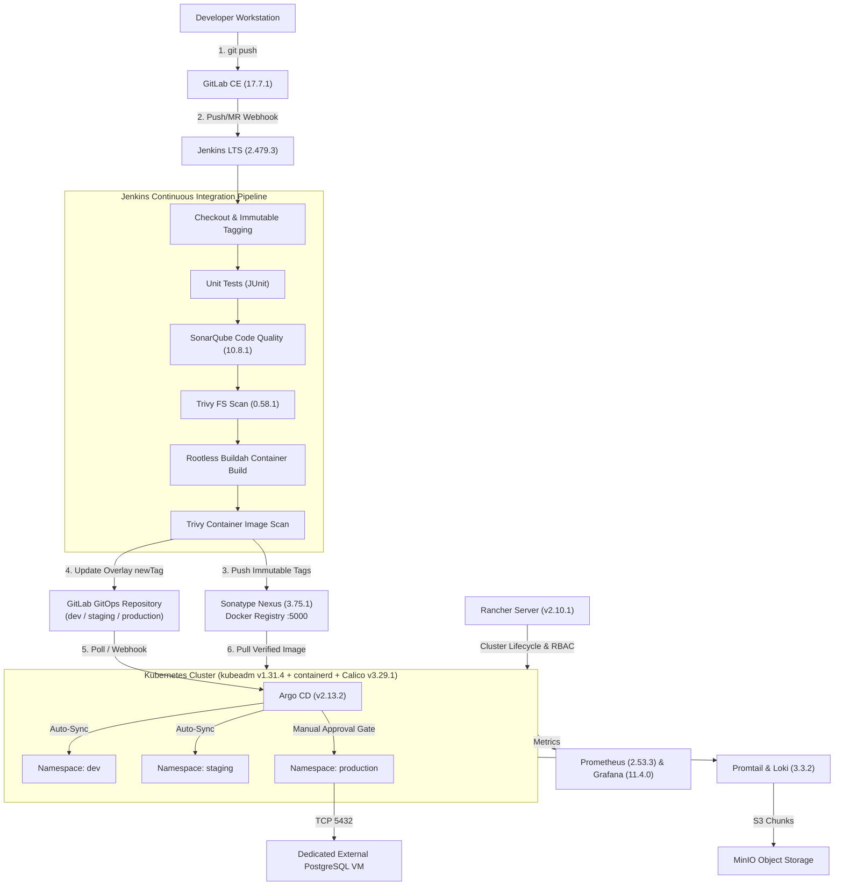

# Platform Architecture Overview

## 1. Executive Summary

The On-Premises DevOps Platform provides a unified, self-hosted software delivery and Kubernetes operations environment built on **Ubuntu Server 24.04 LTS** (`noble`). It supports two deployment targets from a single codebase:

1. **Local Testing Environment:** Automated VM provisioning on a developer workstation via **Multipass** (`multipass/create-vms.sh`) and **Ansible** (`inventories/local/hosts.yml`).
2. **Production Environment:** Manually provisioned **VMware vSphere / ESXi** virtual machines configured with the exact same **Ansible** roles (`inventories/production/hosts.yml`) and documented step-by-step runbooks.

---

## 2. End-to-End CI/CD & GitOps Data Flow

---

## 3. Key Architectural Decisions

1. **Strict Separation of CI and CD:**
   - **Jenkins** executes builds, tests, static analysis, vulnerability scans, image pushes to Nexus, and commits the new immutable image tag to the GitOps repository.
   - **Jenkins never holds Kubernetes cluster-admin credentials** and never executes `kubectl apply` against the cluster.
   - **Argo CD** reconciles cluster state from Git, ensuring full auditability and drift detection.
2. **Rootless Container Builds in CI:**
   - Exposing `/var/run/docker.sock` to CI jobs grants root-equivalent host privileges. Instead, `roles/jenkins` provisions rootless **Podman / Buildah** with user namespace UID/GID mappings (`/etc/subuid` and `/etc/subgid`).
3. **Immutable Image Tagging Policy:**
   - Every build generates three immutable tags (`<semver>-<git-sha>`, `sha-<git-sha>`, `build-<number>`). Both Jenkins (`updateGitOpsRepo.groovy`) and the rollback utility (`scripts/gitops-rollback.sh`) reject the mutable `latest` tag.
4. **Externalized Stateful Production Databases:**
   - Production PostgreSQL databases reside on dedicated VMware VMs (`prod-postgres-01`) outside Kubernetes to isolate disk I/O, simplify PITR (`pgBackRest`), and avoid CNI/CSI overhead on transactional workloads.
5. **Single Codebase Across Local and Production:**
   - Environment differences (domain names, replica counts, JVM heap sizes, VIP endpoints) are parameterized in `inventories/local/group_vars/all.yml` and `inventories/production/group_vars/all.yml`.

